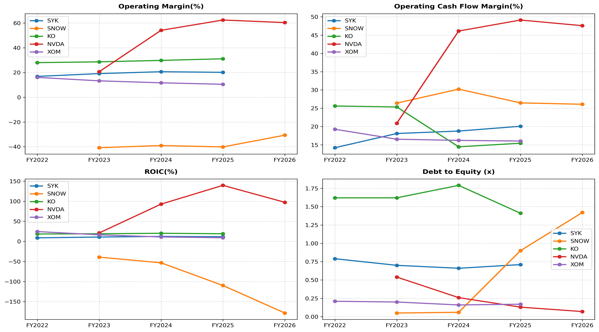

# Multi-Industry Financial Statement & Ratio Analysis Tool

An automated Python pipeline that pulls financial statements via `yfinance`, extracts key income statement, balance sheet, and cash flow line items, and computes 7 fundamental financial metrics across 5 distinct industry business models (SYK, SNOW, KO, NVDA, XOM).

## Target Basket & Business Models
* **Stryker (SYK):** Medical Technology (steady-growth, high R&D)
* **Snowflake (SNOW):** Cloud Software/SaaS (high-growth, negative GAAP margins, cash-flow positive)
* **The Coca-Cola Company (KO):** Consumer Staples (defensive cash flow, high leverage)
* **NVIDIA (NVDA):** Semiconductors (hyper-growth, explosive ROIC and margins)
* **ExxonMobil (XOM):** Integrated Energy (capital-intensive, cyclical commodity drivers)

## Benchmark Visuals

## Core Ratios Analyzed
1. **Operating Profit Margin:** Operational profitability stripped of financing and tax structure.
2. **Operating Cash Flow Margin:** Quality of earnings and cash conversion.
3. **Return on Invested Capital (ROIC):** Efficiency of capital allocation relative to debt and equity.
4. **Return on Equity (ROE):** Net profitability returned on book equity.
5. **Quick Ratio:** Liquidity buffer excluding non-liquid inventory.
6. **Debt to Equity:** Balance sheet leverage and capital structure risk.
7. **Asset Turnover:** Top-line revenue generated per dollar of asset base.

## Project Structure
* `financial_ratio_analysis.ipynb`: Data extraction and ratio engine notebook.
* `output_financial_ratios.xlsx`: Formatted multi-tab Excel model containing historical ratios per company.
* `ratio_trends.png`: 4-panel trend visualization.   
